<div align="center">
  
</div>

<br />

<div align="center">
  <a href="https://vineetnotfound.vercel.app/"></a>
  <a href="https://www.linkedin.com/in/vineet-kushwaha-2666b5257/"></a>
  <a href="mailto:vineetkushwaha6325@gmail.com"></a>
</div>

<br />


### 👨‍💻 System Diagnostic & About Me

I am a **Backend-focused Software Engineer** based in Bengaluru, India. I specialize in designing modular backend systems, building high-throughput APIs, and orchestrating serverless data workflows. I love diving deep into performance tuning, optimizing latency, and solving complex system bottlenecks.

<br />

<div align="center">
  
</div>

<br />

* **🎓 Education:** B.E. in Computer Science & Engineering (Data Science) @ Acharya Institute of Technology (Graduating June 2026, CGPA: 8.7)
* **💡 Philosophy:** Write clean, modular, and self-documenting code. Optimize early where it matters (like reducing latency in real-time interfaces), and build architectures that scale.

<br />


<br />

<div align="center">

<br />

<picture>
  <source media="(prefers-color-scheme: dark)" srcset="https://raw.githubusercontent.com/vineet-k09/vineet-k09/output/github-contribution-grid-snake-dark.svg">
  <source media="(prefers-color-scheme: light)" srcset="https://raw.githubusercontent.com/vineet-k09/vineet-k09/output/github-contribution-grid-snake.svg">
  
</picture> 

<br />

```text
  /\_/\                                   
( o.o )   "Keep building. Stay curious."
  > ^ <                                   
```

</div>
